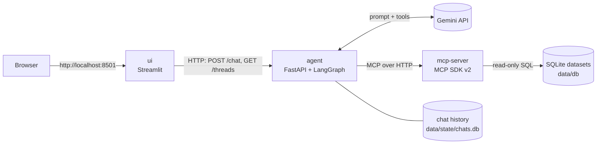

# Eddie's Query Agent

Ask questions about your data in plain English. An LLM agent writes the SQL, runs it through an
MCP server, and shows you the result as a table you can download.

```
> Which 3 movie genres have the highest average rating?
  -> movies_query: SELECT genre, AVG(rating) AS avg_rating FROM main.movies GROUP BY genre ORDER BY avg_rating DESC LIMIT 3
  genre       | avg_rating
  Documentary | 6.049080882352941
  Thriller    | 6.029859719438878
  Romance     | 6.027176220806794
> now only for movies after 2010
  -> movies_query: ... WHERE year > 2010 GROUP BY genre ...
```

**v1 status:** done. Question → SQL → table works end to end in three containers, with chat sessions,
a chat list and SQL-error retry. See [docs/DESIGN.md](docs/DESIGN.md) for how it works and why.

## Architecture



| Container | Port | Job |
|---|---|---|
| `query-agent-ui` | 8501 | Chat page: sidebar with chats, question box, tables + CSV download |
| `query-agent-agent` | 8001 | The agent: LLM ↔ tool loop, chat sessions, HTTP API |
| `query-agent-mcp` | 8000 | MCP server: one query tool and one "boundary" tool per dataset, with safety rules |

## Quick start

You need Docker and a free Gemini API key from [Google AI Studio](https://aistudio.google.com).

```bash
git clone https://github.com/xunluo776/query-agent.git
cd query-agent
cp .env.example .env          # then put your key after GOOGLE_API_KEY=
docker compose up -d --build  # starts all 3 containers
```

Open **http://localhost:8501** and ask a question, for example:

- *How many videos are in each category?*, then the follow-up *only show the top 3*
- *How many movies were released in the last 5 years of the data?* (the agent checks the year range first)
- *How many customers gave positive feedback, by occupation?*

Stop with `docker compose down`. Your chats are kept in `data/state/chats.db`.

## Sample data

Three small SQLite datasets are included in `data/db/`:

| Dataset | Table | Rows | About |
|---|---|---|---|
| `videos` | `videos` | 12,000 | YouTube-style videos: views, likes, upload times, categories |
| `movies` | `movies` | 5,000 | Budgets, revenue, ratings and genres, 1980–2024 |
| `food_delivery` | `customers` | 388 | Survey of food delivery customers in Bangalore |

Adding a dataset needs no code: one SQLite file, two yaml files and one line in `mcp-server/server.yaml`
(see [Adding a dataset](docs/DESIGN.md#6-adding-a-dataset)).

## Other ways to run it

| What | Command |
|---|---|
| Terminal chat instead of the browser | `uv run agent` (with the containers running) |
| API test page | http://localhost:8001/docs |
| Watch what the agent does | `docker compose logs agent -f` |
| MCP server alone, in the MCP Inspector | `npx @modelcontextprotocol/inspector`, then connect to `http://localhost:8000/mcp` |

For local development: [uv](https://docs.astral.sh/uv/) and Python 3.12, then `uv sync --all-packages`.

## Project layout

```
mcp-server/   MCP server: server.yaml (settings + tool registry), tools/*.yaml, tables/*.yaml, db.py (all SQL access)
agent/        settings.yaml, system_prompt.md, graph.py (LangGraph loop), api.py (FastAPI), cli.py
ui/           app.py (Streamlit)
data/         db/ (datasets), state/ (chat history, not in git), scripts/load_csv.py (CSV → SQLite)
compose.yaml  the 3 services
```

## Tech

Python 3.12 · [uv](https://docs.astral.sh/uv/) workspace · MCP Python SDK v2 · LangGraph + LangChain ·
Gemini (`gemini-3.5-flash-lite`) · FastAPI · Streamlit · SQLite · Docker Compose
