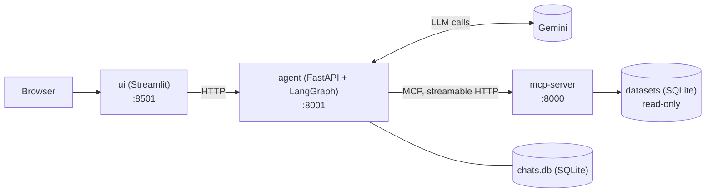
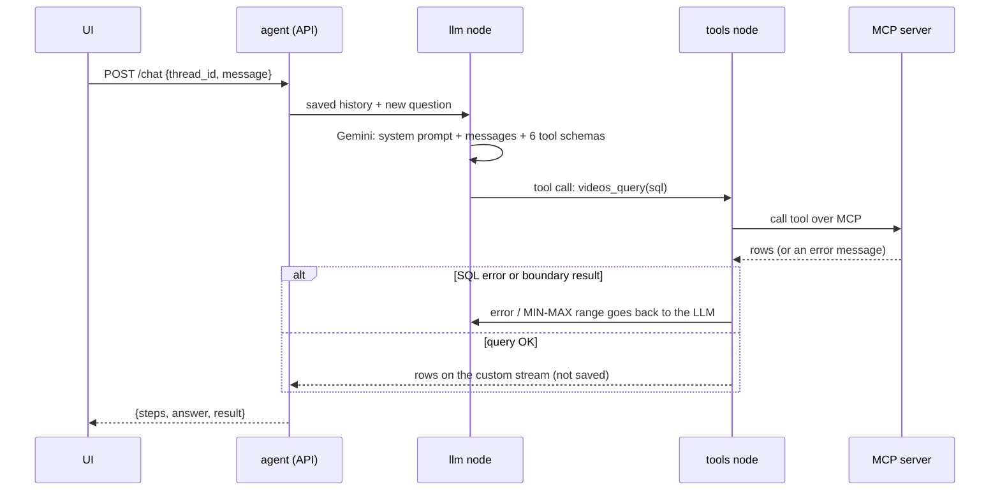

# Design: Eddie's Query Agent (v1)

This document explains how the query agent works and why it is built this way.
For setup, see the [README](../README.md).

## 1. Goal and scope

**Goal:** a user asks a question about a dataset in plain English and gets the answer as a table.

**v1 scope: "pass-through".** The LLM writes SQL, the database runs it, and the rows go
**straight to the user**. The LLM never reads the result rows.

| In v1 | Not in v1 (see [§9](#9-v2-and-later)) |
|---|---|
| Lookup questions answered by one SQL query | The LLM reading and explaining results |
| Retry when the database rejects the SQL | Retry because the result looks wrong (e.g. 0 rows) |
| Chat sessions with follow-up questions | Summarizing long chats |
| Chat list, delete, CSV download | Run logs, tracing, evals |

**Why pass-through first:** it keeps the LLM's job small (write correct SQL), keeps results out of the
context window (a result can be up to 10,000 rows), and makes "did it work?" easy to check: the SQL either
runs or it doesn't. Whether the SQL *answers the question well* is a quality problem for evals, not
something v1 checks.

## 2. Architecture



Three containers, one job each. Each one talks only to its neighbor:

- **ui** only calls the agent's HTTP API. It never talks to Gemini or MCP.
- **agent** owns the LLM loop and the chat history. It reaches data only through MCP tools.
- **mcp-server** owns all database access and the safety rules. It knows nothing about LLMs.

The containers find each other by Compose service name (`http://agent:8001`, `http://mcp-server:8000/mcp`).
The data folder is mounted **read-only** into the MCP server. The API key is passed to the agent at
runtime from `.env` and is never part of an image.

## 3. Request flow

What happens for one question:



## 4. Components

### 4.1 MCP server (`mcp-server/`)

**Config-driven tools.** The server reads three kinds of yaml files at startup:

```
server.yaml           settings (db_dir, row_limit, timeout, allowed hosts) + tool registry
  └─ tools/videos.yaml  dataset description + its MCP tools
       └─ tables/videos.yaml  table name, database file, every column with its meaning
```

`register_tools` turns each tool entry into an MCP tool. Its description = tool text + dataset text +
every table and column, so the LLM sees the full schema up front and doesn't need a "describe table" call.

**Two tools per dataset, one implementation.** `<name>_query(sql)` runs the real query.
`<name>_discover_boundary(sql)` is the same code with a different description: the LLM must call it
first for time questions (`SELECT MIN(year), MAX(year) ...`), so it knows what range the data covers
before it writes "last 5 years".

**Startup checks.** Pydantic models validate every yaml (unknown keys are errors). The described columns
must match the real table, and each tool's `input` must match the implementation's parameters. A bad yaml
stops the server with a clear message instead of misleading the LLM later.

**Safety rules** (`db.py`, the only file that touches SQLite):

| Rule | How |
|---|---|
| Read-only | the connection is opened with `mode=ro` |
| Only SELECT, only this dataset's tables | `set_authorizer` allowlist (blocks PRAGMA, ATTACH, other tables, `sqlite_master`) |
| No runaway queries | `set_progress_handler` stops a query after 5 s |
| No huge results | the SQL is wrapped in `SELECT * FROM (...) LIMIT 10001`; the extra row sets `truncated` |
| Errors the LLM can fix | SQLite's message goes back as `ToolError` (the SDK hides other exceptions) |
| No requests from unknown hosts | `allowed_hosts` / `allowed_origins` in `server.yaml` (DNS-rebinding protection) |

### 4.2 Agent (`agent/`)

**The loop is a small LangGraph graph** (`graph.py`), not the ready-made `create_agent`, because
`create_agent` always feeds tool results back to the LLM, which would break pass-through.

```
START -> llm --no tool call--> END          (text answer, e.g. "no dataset fits")
          |
      tool call
          v
        tools --query OK--> END             (rows sent to the user)
          |
  boundary result / SQL error
          v
         llm                                (reads the range or the error, writes the next SQL)
```

- **State:** `messages` + a `query_ok` flag. The rows are **not** in the state: the tools node sends them
  out with LangGraph's custom stream (`get_stream_writer()`), and the LLM only gets the note
  "Query OK: N rows sent to the user".
- **Stop rule:** LangGraph's `recursion_limit` (8 node runs ≈ 4 LLM calls) protects the free-tier quota.
- **Model:** Gemini `gemini-3.5-flash-lite` through `langchain-google-genai`. The chain is
  `system prompt (system_prompt.md) + messages → model.bind_tools(tools)`.
- **MCP client:** `langchain.mcp` (`MCPAdapter`) turns the server's tools into LangChain tools.
  A server `ToolError` arrives as a `ToolMessage` with `status="error"`, which is how the graph routes a retry.

**Chat sessions** use LangGraph's checkpointer: `AsyncSqliteSaver` saves each chat's messages under its
`thread_id` in `data/state/chats.db`. The same `thread_id` continues the chat, so follow-ups like
"only after 2010" work: the LLM sees its earlier SQL and changes it. A small `threads` table in the same
file lists the chats for the sidebar.

**HTTP API** (`api.py`, FastAPI; the graph is built once at startup):

| Endpoint | Job |
|---|---|
| `POST /chat {message, thread_id}` | run one question; returns `{thread_id, steps, answer, result}` |
| `GET /threads` | chat list, most recent first |
| `GET /threads/{id}` | one chat's history: question, steps (tool, SQL, error) and answer per turn |
| `DELETE /threads/{id}` | delete a chat (saved messages + list entry) |
| `GET /health` | is the service up |

### 4.3 UI (`ui/app.py`)

A ChatGPT-like Streamlit page at `/chat`:

- **Sidebar:** "New chat" + one button per chat (first 8 characters of its id). A delete icon appears on hover.
- **Fresh chat:** a big title and a text box in the middle. The first message makes a new `thread_id`.
- **Each answer:** a "What the agent did" expander (tool, SQL, errors), then the table and a CSV download.
- **Tables live only in the page session** (`st.session_state`). After a refresh, older answers show their
  SQL and "ask again to see it". This is on purpose (see §5).

## 5. Key decisions

| Decision | Why | Trade-off |
|---|---|---|
| **Rows are never stored**, not in the state, the chat DB or the LLM context | Results can be 10k rows; storing them makes `chats.db` grow fast, and v1 doesn't need old tables | Old tables are gone after a refresh; ask again to see them |
| **MCP server as its own service** | Data access and safety live in one place, usable by any MCP client (we tested it in the MCP Inspector first) | One more container and protocol hop |
| **SQLite for datasets and chat history** | No database server; fits in 8 GB RAM; good for a demo | All DB access sits behind one module (`db.py`) and the checkpointer interface, so Postgres is a one-file swap |
| **Gemini free tier** instead of a local model | 8 GB RAM is too tight for a local model + Docker, and a stronger model makes far fewer tool/SQL mistakes | ~50 requests/day on the free tier, so tests are kept small |
| **`langchain.mcp` (beta)** instead of `langchain-mcp-adapters` | The adapters package requires MCP SDK v1 (`mcp<2`); the server uses SDK v2, and one uv workspace = one lock file | Beta API; only `mcp_connection.py` uses it, so a change touches one file |
| **Own LangGraph graph** instead of `create_agent` | Needed for pass-through routing (query OK → END without the LLM) | ~70 lines we maintain |
| **"Boundary first" by prompt**, not a graph node | The graph can't tell a time question without asking the LLM | The model may skip it; evals would show how often |
| **Config in yaml, not code** (hosts, URLs, limits, datasets) | Adding a dataset or a host is a config edit | More files per dataset (3) |

## 6. Adding a dataset

1. Put the SQLite file in `data/db/` (`data/scripts/load_csv.py` turns CSVs into one).
2. Add `mcp-server/src/mcp_server/tables/<table>.yaml`: table name, database file, every column with a description.
3. Add `mcp-server/src/mcp_server/tools/<name>.yaml`: dataset description, the table list, the two tools.
4. Add one entry under `tools:` in `mcp-server/server.yaml`, then `docker compose up -d --build`.

No code changes. The server checks the yaml against the real table at startup.

## 7. Testing done for v1

All checks were run by hand or with small scripts (no test suite yet):

- **MCP server:** every tool in the MCP Inspector over HTTP; bad SQL, a missing column, `sqlite_master`,
  DELETE/DROP/PRAGMA/ATTACH, another dataset's table, timeout, the 10k row cap; unknown Host → 421,
  unknown Origin → 403.
- **Agent:** simple question (1 LLM call); time question (boundary → query, 2 calls); live SQL-error retry
  (`likes_count` → error → `likes` → 10k rows); follow-up in the same chat; chat survives a restart;
  rows don't appear in `chats.db`.
- **UI:** headless with Streamlit's `AppTest` (fresh chat, open chat, follow-up, new chat, delete) and by
  hand in the browser.

## 8. Known limits

- **Answer quality is not measured.** The agent can write SQL that runs but misses the point
  (e.g. returns the top category without its total). That is what evals are for.
- **Free-tier limits:** ~50 requests/day; each question costs 1–3. The 6 tool descriptions are ~2.7k input
  tokens per call, and a chat's whole history is sent again with each message.
- **The schema is sent twice per dataset** (both tools carry the column list). Fine for 3 datasets; many
  datasets would need tool shortlisting.
- **No users or auth.** Anyone who can reach port 8501 sees every chat.
- **Small gaps:** `SELECT COUNT(*) FROM sqlite_master` passes the allowlist (it leaks only the number of
  schema objects); the sidebar's hover CSS depends on Streamlit's internal class names.

## 9. v2 and later

**v2: the agent reads and explains results.**

- Small results go back to the LLM so it can answer in words ("Music leads with 2.7B views").
- Above a read cap (~30 rows), the LLM sees only the columns, the row count and the first few rows.
- A per-session **DuckDB result store** keeps results so follow-ups can analyze them
  (`query_result(result_id, sql)`) without querying the source again.
- Insight questions ("what makes a video go viral?") that need several queries.

**Later:** evals (a fixed question set to measure SQL quality), tracing (LangSmith or Langfuse), chat names
made from the first message, tool shortlisting for many datasets, Postgres instead of SQLite.
